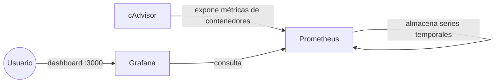
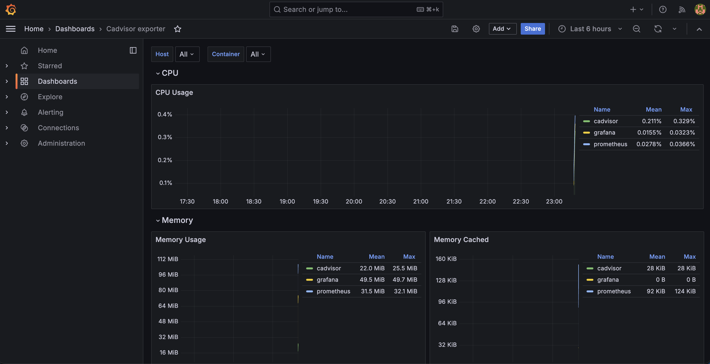
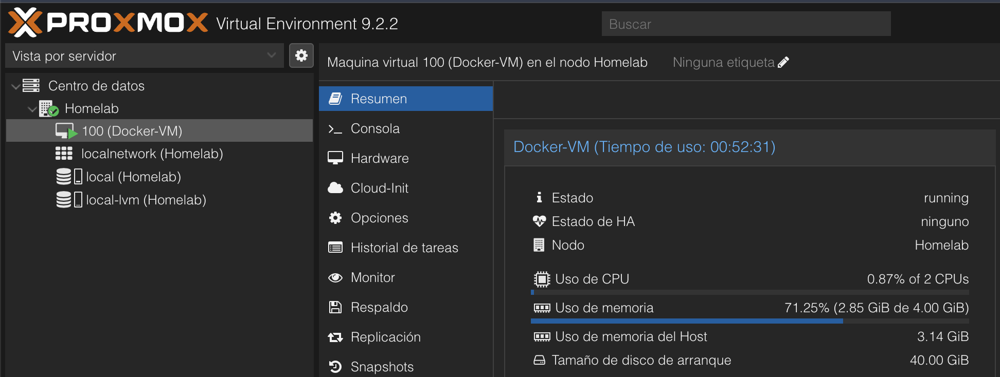

# Homelab Monitoring Stack


Stack de monitorización para contenedores Docker, desplegado con `docker-compose` como parte de mi homelab personal. Recolecta métricas de uso de CPU, memoria, red y disco de cada contenedor y las visualiza en dashboards de Grafana.

## Arquitectura



- **cAdvisor**: recoge métricas de cada contenedor Docker en tiempo real (CPU, RAM, red, I/O).
- **Prometheus**: hace scraping periódico de cAdvisor y almacena el histórico de métricas.
- **Grafana**: consulta Prometheus y las representa en dashboards visuales.

Solo el puerto de Grafana (`3000`) se publica al host; Prometheus y cAdvisor solo son accesibles dentro de la red interna de Docker, reduciendo la superficie expuesta.

## Stack técnico

| Componente | Imagen | Función |
|---|---|---|
| cAdvisor | `gcr.io/cadvisor/cadvisor` | Exportador de métricas por contenedor |
| Prometheus | `prom/prometheus` | Base de datos de series temporales |
| Grafana | `grafana/grafana` | Visualización y dashboards |

## Puesta en marcha

1. Clona el repositorio:
   ```bash
   git clone https://github.com/vdiaz/homelab-monitoring.git
   cd homelab-monitoring
   ```

2. Copia el archivo de variables de entorno y define tus propias credenciales:
   ```bash
   cp .env.example .env
   ```
   Edita `.env` y establece un usuario y contraseña fuertes para Grafana.

3. Levanta el stack:
   ```bash
   docker compose up -d
   ```

4. Accede a Grafana en [http://localhost:3000](http://localhost:3000) con las credenciales definidas en `.env`.

5. Añade un dashboard de cAdvisor (por ejemplo, el dashboard público `#14282` de [grafana.com](https://grafana.com/grafana/dashboards/)) importándolo desde el menú *Dashboards → Import*.

## Notas de seguridad

- Las credenciales de Grafana se gestionan por variables de entorno (`.env`), que **nunca se sube al repositorio** (ver `.gitignore`).
- `cAdvisor` y `Prometheus` no exponen ningún puerto al host: solo son accesibles desde dentro de la red Docker interna, minimizando la superficie de ataque.
- Se recomienda cambiar la contraseña de administrador de Grafana en el primer inicio de sesión y desactivar el registro público de usuarios (`GF_USERS_ALLOW_SIGN_UP=false`, ya incluido).
- Para exponer Grafana fuera de la red local, usar un proxy inverso con TLS (Nginx + certificado) o una VPN tipo Tailscale/WireGuard, nunca publicar el puerto directamente a internet.

## Capturas





## Sobre este proyecto

Parte de una serie de proyectos de homelab orientados a practicar administración de sistemas, contenedores y observabilidad, documentados en mi portfolio.

## Licencia

MIT — ver [LICENSE](LICENSE)
